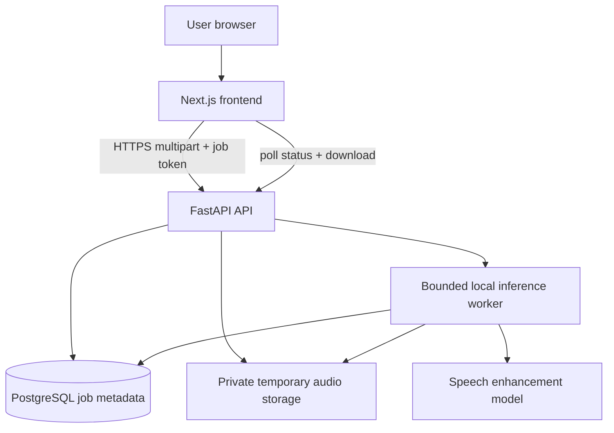

# Architecture (target, not implemented)



## Monorepo target
```
nirava/
  frontend/
    src/app/{layout.tsx,page.tsx,globals.css}
    src/components/{audio,layout,ui}/
    src/hooks/useEnhancementJob.ts
    src/lib/api.ts
    src/types/audio.ts
    public/
    package.json
  backend/
    app/main.py
    app/api/v1/{health.py,enhancement.py}
    app/core/{config.py,security.py}
    app/db/{session.py,models.py}
    app/schemas/enhancement.py
    app/services/{audio.py,enhancer.py,storage.py,model_loader.py,job_runner.py}
    alembic/versions/
    tests/
    pyproject.toml
  infra/compose.yaml
  docs/
  scripts/
  AGENTS.md
  README.md
  .gitignore
  .env.example
```

## Execution
- Satu FastAPI instance dengan worker inference terbatasi untuk demo; PostgreSQL menjaga status tetapi tidak menjalankan pekerjaan.
- Hindari pemrosesan berat langsung pada request thread. Job yang terputus saat restart ditandai gagal saat startup.
- Model dimuat sekali per worker. Atur konkurensi sesuai CPU/GPU.
- Penyimpanan file privat di luar web root, direktori runtime tidak masuk Git.
- Di deployment multi-instance, gunakan object storage + durable queue; jangan anggap filesystem lokal bersama.
- Validasi codec dengan decoder, batasi ukuran dan durasi, terapkan timeout.

## Trade-off
PostgreSQL lebih berat daripada SQLite untuk MVP tetapi dipilih untuk deployment persisten dan pembelajaran skema. Next.js lebih fleksibel untuk desain daripada Streamlit tetapi menambah kompleksitas TypeScript.

## Admission, audio, dan cleanup
- Antrean lokal harus berbatas; tolak dengan 429 sebelum mengembalikan 202 bila kapasitas penuh. Pada restart, tandai pending/processing yang terputus sebagai failed dengan kode aman dan bersihkan file parsial.
- Decoder memvalidasi sample rate positif dan batas channel/sample rate yang disepakati melalui uji model; nilai dukungan masih keputusan Stage 1, bukan kemampuan yang telah diuji. Resampling ke kebutuhan model hanya dilakukan backend, dengan batas decoded samples/memori dan timeout.
- Scheduler cleanup berjalan berkala dan saat startup. Tandai expired sebelum menghapus file; retry kegagalan penghapusan. Worker memeriksa status sebelum mempublikasikan hasil agar tidak menghidupkan job yang dihapus.
- Token/hash, isi audio, dan path privat tidak dicatat pada log. Semua akses job melewati FastAPI.

- Untuk MVP gunakan satu proses API (satu Uvicorn worker) dan satu pengelola antrean lokal berbatas. Banyak proses API tidak boleh masing-masing menjalankan recovery startup terhadap job aktif proses lain.
- Target cleanup: sweep setiap 5 menit serta saat startup; expiry memblokir akses langsung pada request. Batas waktu penghapusan fisik 5 menit hanya target operasi normal, bukan jaminan saat outage. Status expired tidak boleh berubah kembali; hapus output terlambat dan retry saat storage pulih.
